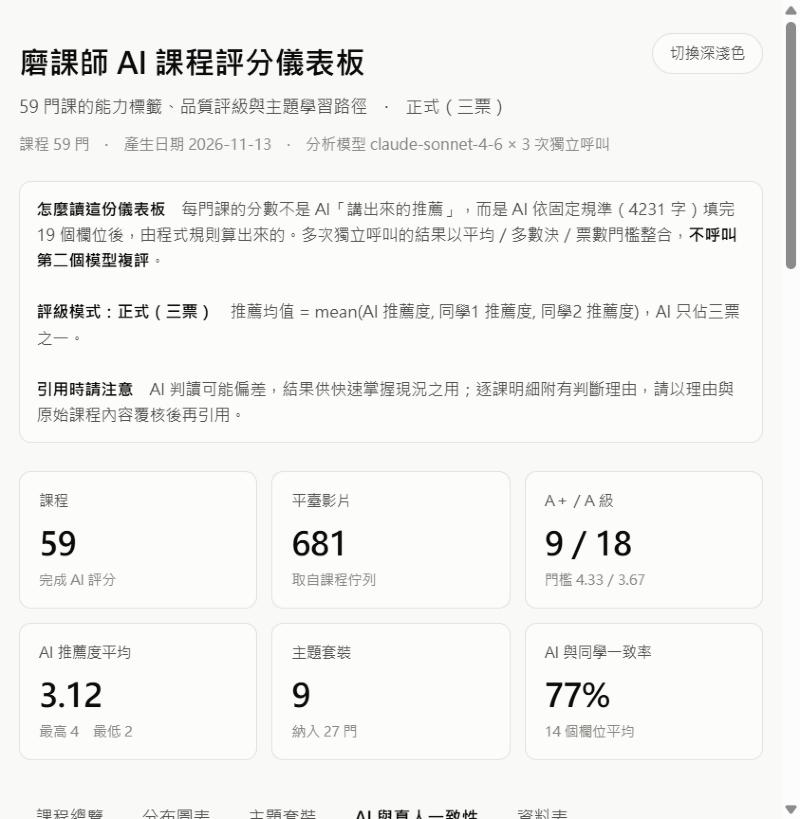
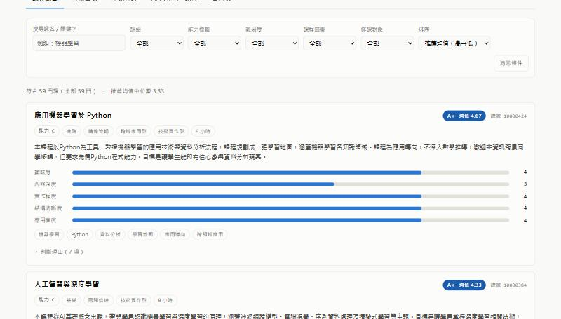
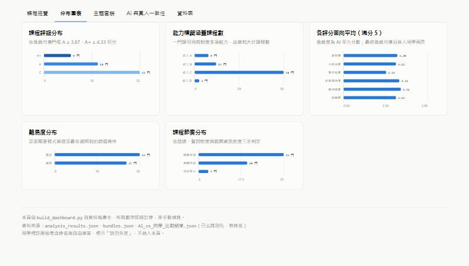
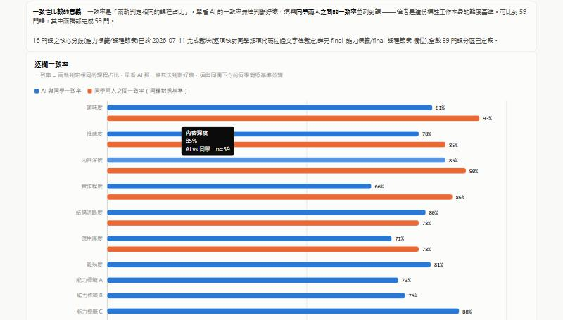
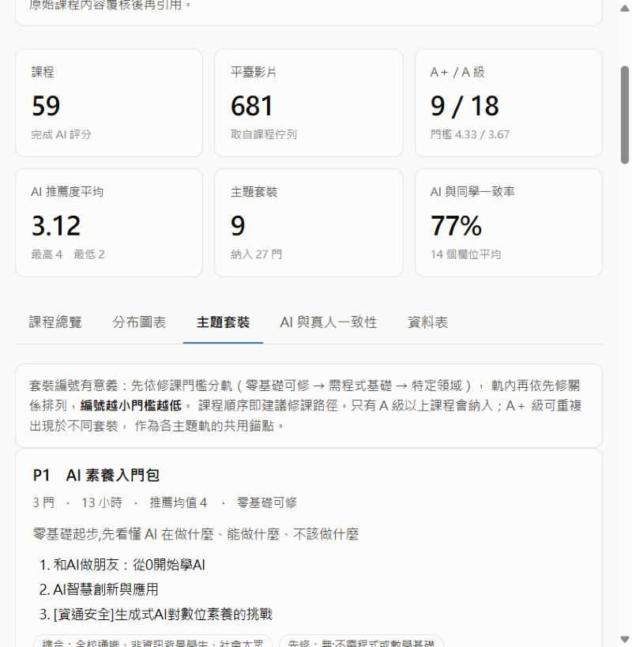

# 磨課師 AI 課程評分工具（moocs-rating-tools）

以人工智慧分析課程**影音內容**，產出能力標籤、品質評級與主題式學習路徑，
再以**真人實際觀看課程**的獨立標註交叉驗證。

- **執行單位**　國立臺灣師範大學電機工程學系
- **計畫**　磨課師 AI 課程系統性盤點與能力導向學習路徑建構計畫
- **適用對象**　各校／各單位自行盤點課程品質與能力對應

> 本工具是「磨課師 AI 課程盤點計畫」的程式交付版：把原本散落在 100 多支一次性腳本中的
> 流程，整理成六支可重複執行的命令列工具，並把評分規準、欄位定義與管線參數
> 全部外部化成設定檔。**換一批課程、換一個領域，改設定檔即可，不需改程式碼。**

---

## 一、這套工具在做什麼

平臺上可得的結構化資訊只有課名、開課單位、時數與一段招生文案，回答不了
「這門課需不需要程式基礎」「教到什麼深度」「該先修哪一門」。

本工具的作法不是請 AI 推薦課程，而是：

> **讓 AI 對每一門課回答同一組固定問題，再把答案交給人驗證。**

推薦分數是最後算出來的，不是 AI 講出來的 ——

```
推薦均值 = mean(AI 推薦度, 同學1 推薦度, 同學2 推薦度)
```

AI 只佔三票之一。實測佐證：**AI 在推薦度從未給過 5 分，平均較同學嚴格 0.45 分**，
9 門 A+ 課程全部是靠同學的高分推上去的。











---

## 二、整體流程

```
config/course_ids.txt（要盤點的課程 ID）
        │
  ① fetch_courses       自平臺取課名、簡介、章節、影片位址 → moocs_queue.json
        │
  ② preprocess_courses  下載影片 → 章節感知抽樣 → 抽幀合併 ＋ 切音訊 → Whisper 轉逐字稿
        │               （不呼叫 LLM、不耗 API 額度，可中斷續跑）
        │               → merged/*.jpg（視覺輸入）＋ merged/*_analysis.txt（文字輸入）
        │
  ③ rate_courses        依 config/prompt.txt 的規準做 N 次獨立呼叫
        │               → Python 規則整合（平均／多數決／票數門檻）
        │               → analysis_results.json、rating.csv、failed.csv
        │
  ④ compare_students    AI 與真人標註逐欄比對一致率（純統計，不呼叫 API）
        │               → AI_vs_同學_比對報告.xlsx、AI_vs_同學_比對結果.json（去識別化）
        │
  ⑤ build_bundles       推薦均值 → 切 A+／A／C → 組出主題套裝 → bundles.json
        │
  ⑥ build_dashboard     組成單一互動 HTML 儀表板（可離線開啟）
```

**流程中沒有的東西**（常被誤以為有，故先敘明）：
沒有 OCR（截圖直接送進模型的視覺輸入）、沒有 embedding 或向量檢索、
沒有使用結構化輸出 API、**沒有第二個模型複評**（③ 的整合是 Python 規則函式，不呼叫模型）。

---

## 三、執行需求

- Python 3.11+
- 外部工具：`ffmpeg`、`ffprobe`（前處理用）、`yt-dlp`（YouTube 影片）
- `rate_courses` 需要可連線的 LLM API，金鑰請設為環境變數，**勿寫死在程式碼中**
- `fetch_courses` 需要 Playwright 瀏覽器核心與平臺登入狀態
- exe 檔只適用 Windows；其他平台請走 Python 路徑

依賴分成三層，只裝用得到的那層即可：

```bash
pip install -e .                 # ③④⑤⑥ 評分、比對、分級、儀表板
pip install -e .[preprocess]     # 再加 ② 影音前處理（會裝 whisper／opencv，體積大）
pip install -e .[fetch]          # 再加 ① 平臺抓取
pip install -e .[all]            # 完整管線

playwright install chromium      # 只有要跑 ① 時需要
cp .env.example .env             # 填入 ANTHROPIC_API_KEY
```

`whisper`／`opencv` 僅由前處理相關函式使用（`moocs_core` 以函式內延遲載入），
因此只跑評分與儀表板的人不必安裝這兩套，exe 也不會把它們打包進去。

> `cookies.txt`、`session.json`、`.env` 含個人登入憑證，**已列入 `.gitignore`，不得外流**。

---

## 四、怎麼跑

先做連線與設定自我檢查，確認金鑰、規準與輸出格式都通：

```bash
python tools/test_llm.py --live
```

| 步驟 | 指令 | 說明 |
|---|---|---|
| 0 | `python save_login.py` | 登入平臺一次，產生 `session.json` |
| ① | `python fetch_courses.py` | 取課程清單與影片位址 → `moocs_queue.json` |
| ② | `python preprocess_courses.py` | 下載、抽樣、抽幀、轉逐字稿（**不耗 API 額度**，可中斷續跑） |
| ③ | `python rate_courses.py` | 只讀已備妥的 `merged/` 呼叫模型。含花費上限與 `failed.csv` |
| ④ | `python compare_students.py --students 同學標註.xlsx` | AI 與真人標註交叉比對 |
| ⑤ | `python build_bundles.py --source 定稿標籤表.xlsx` | 分級與主題套裝 |
| ⑥ | `python build_dashboard.py` | 產生單一互動 HTML 儀表板 |
| ＋ | `python build_traceability.py` | 產生證據鏈索引（課程 → 影片 → 檔案 → 結果） |

**② 與 ③ 刻意分離**：前處理不耗 API 額度，可以先把影片一次處理完；
模型分析隨時中斷續跑，不必重抓影片。

各工具都支援 `--help`、`--limit`（分批）、`--only`（指定課程）。
`rate_courses` 另有 `--dry-run`（只檢查備齊狀況與規模，不呼叫模型）。

---

## 五、設定檔（換領域只改這裡）

| 檔案 | 內容 | 什麼時候要改 |
|---|---|---|
| `config/prompt.txt` | 評分規準（4,231 字）| 換領域一定要改：判準、錨點、固定詞庫都與領域綁定 |
| `config/fields.json` | 19 個輸出欄位的型別、整合規則、驗證規則 | 換欄位時改 |
| `config/pipeline.json` | 抽樣、抽幀、音訊、模型、分級門檻、檔名 | 調參數時改 |
| `config/course_ids.txt` | 要盤點的課程 ID（一行一個）| 換一批課程時改 |
| `bundles_data.py` | 能力架構、主題套裝定義、學習目標 | 換能力架構或套裝時改 |
| `dashboard_template.html` | 儀表板版面 | 改外觀時改 |

### `config/fields.json` 的意義

舊版把 19 個欄位名稱寫死在**三個地方**（規準、整合函式、驗證函式），
換一個領域必須同步改三處，這是舊版交付文件列為「已知限制」的項目。

本版把其中兩處抽成資料：整合與驗證改由 `fields.json` 驅動
（`moocs_config.merge_results` / `moocs_config.validate_result`），
換領域只需改 `fields.json` 與 `prompt.txt`。

`merge` 可用值：

| 值 | 行為 | 用在 |
|---|---|---|
| `mean` | 平均後取整（1–5）；全距 ≥ 2 標記「分歧大」 | 六個評分面向 |
| `majority` | 多數決；無任一選項達 2 票標記「三者分歧」 | 難易度、課程節奏 |
| `vote` | 票數達 `min_votes` 才列入 | 能力標籤、關鍵字、細項代碼 |
| `any` | 任一次勾選即列入 | 修課對象三型（可複選） |
| `longest` | 取最長的一份文字 | 課程摘要 |
| `longest_per_key` | 逐子項取最長 | 判斷原因（7 項） |

另有 `derived_rules`，例如「實作程度 ≥ 3 必為技術實作型」的一致性補強。

---

## 六、AI 與人的分工（不可混談）

| | 誰做 | 做什麼 |
|---|---|---|
| **AI 分析** | LLM × N 次獨立呼叫 | 依 `prompt.txt` 的規準，對每門課填 19 個固定欄位並寫出判斷理由 |
| **規則整合** | Python | N 次結果以平均／多數決／票數門檻合併，**不呼叫模型** |
| **真人標註** | 同學 | 實際觀看課程影片，每門課兩輪、由不同人獨立填同一組欄位 |
| **一致性比較** | 統計程式 | 逐欄一致率；另以**同學兩人之間的一致率**作為對照基準 |
| **最終評級** | 規則 | 推薦均值三票平均 → 統一門檻切 A+／A／C |

一致率要怎麼讀：單看 AI 的一致率無法判斷好壞，須與同欄的同學對照基準並讀 ——
後者是這份標註工作本身的難度基準。儀表板的「AI 與真人一致性」分頁把兩者並列。

---

## 七、系統架構

六支命令列工具，加一層核心函式庫與設定載入層：

```text
fetch_courses       ① 平臺抓取          → moocs_queue.json
preprocess_courses  ② 影音前處理        → merged/*.jpg + *_analysis.txt
rate_courses        ③ LLM 評分          → analysis_results.json / rating.csv
compare_students    ④ 一致性比對        → 比對報告.xlsx / 比對結果.json
build_bundles       ⑤ 分級與主題套裝    → bundles.json / course_grades.csv
build_dashboard     ⑥ 互動儀表板        → dashboard.html
build_traceability  ＋ 證據鏈索引        → 證據鏈索引.xlsx

moocs_core.py       核心：下載、抽樣、抽幀、轉文字、模型呼叫、整合、驗證
moocs_config.py     設定載入層：prompt / fields / pipeline，以及 schema 驅動的整合與驗證
bundles_data.py     領域設定：能力架構、套裝定義、學習目標
corpus.py           語料清點（影片、音訊、逐字稿數量與完整性）
```

### 專案結構

```text
.
├─ pyproject.toml              # 依賴與打包設定
├─ .python-version
├─ .env.example                # 複製成 .env 後填入金鑰
├─ fetch_courses.py            # ① 平臺抓取
├─ preprocess_courses.py       # ② 影音前處理（不耗 API）
├─ rate_courses.py             # ③ LLM 評分
├─ compare_students.py         # ④ AI vs 真人一致性
├─ build_bundles.py            # ⑤ 分級與主題套裝
├─ build_dashboard.py          # ⑥ 互動儀表板
├─ build_traceability.py       # ＋ 證據鏈索引
├─ moocs_core.py               # 核心函式庫
├─ moocs_config.py             # 設定載入 ＋ 整合／驗證規則
├─ bundles_data.py             # 領域設定（能力架構、套裝）
├─ corpus.py                   # 語料清點
├─ save_login.py               # 平臺登入，產生 session.json
├─ dashboard_template.html     # 儀表板樣板
├─ config/
│   ├─ prompt.txt              # 評分規準（LLM system prompt）
│   ├─ fields.json             # 19 欄位定義與整合／驗證規則
│   ├─ pipeline.json           # 抽樣／抽幀／音訊／模型／門檻
│   └─ course_ids.txt          # 要盤點的課程 ID
├─ data/                       # 本計畫 59 門課的實際結果（範例資料）
├─ doc/                        # 安裝與使用說明
├─ references/                 # 儀表板畫面
├─ release/                    # exe 與 release-win.zip
└─ tools/
    ├─ build.py                # 打包 exe
    └─ test_llm.py             # 連線與設定自我檢查
```

---

## 八、關鍵參數

全部位於 `config/pipeline.json`。

| 參數 | 值 | 意義 |
|---|---|---|
| `sampling.max_sample` | 8 | 每門課分析影片數硬上限 |
| `sampling.max_per_chapter` | 2 | 長課每章節取前 1 + 中 1 |
| `sampling.short_course_threshold` | 8 | 影片數 ≤ 此值的課程全部分析 |
| `frames.frames_per_video` | 3 | 每支影片抽幀數（位置 1/4、2/4、3/4）|
| `frames.skip_seconds` | 10 | 頭尾各跳過的秒數（避開片頭片尾）|
| `frames.merge_cols` | 5 | 合併接觸表欄數（384×216 縮圖）|
| `audio.segments` × `segment_minutes` | 3 × 2 分鐘 | 開頭／中間／結尾各取一段 |
| `transcript.whisper_model` | `base` | 本機語音辨識模型 |
| `transcript.truncate_chars` | 5000 | 送入模型的逐字稿長度 |
| `llm.model_priority` | `claude-sonnet-4-6` | 分析用模型 |
| `llm.num_agents` | 3 | 同一輸入的獨立呼叫次數 |
| `llm.max_tokens` | 2500 | 單次回應上限 |
| `llm.cost_cap_usd` | 9.5 | 估算花費上限，達到即停止（可續跑）|
| `grading.a_threshold` / `aplus_threshold` | 3.67 / 4.33 | A 級與 A+ 級的推薦均值門檻 |

temperature **刻意未設定** —— 該模型帶此參數會回 400。

---

## 九、本計畫的產出規模

`data/` 收錄本計畫 59 門課的實際結果，可直接產生儀表板當範例。

| 項目 | 數量 |
|---|---|
| 課程 | 59 門 |
| 平臺影片 | 819 支（YouTube 270 / 平臺 MP4 549）|
| 實際分析影片 | 258 支（31.5%）|
| 音訊片段 | 758 段（與逐字稿一一對應）|
| 逐字稿 | 758 段 · 441,118 字 |
| 合併截圖 | 63 張 |
| 真人標註 | 15 位同學 · 118 筆 |
| 課程評級 | A+ 9 門 / A 18 門 / C 32 門 |
| 主題套裝 | 9 組 · 納入 27 門 |

```bash
# 用內附資料直接看儀表板長什麼樣
python build_bundles.py --source "磨課師AI課程能力分類標籤表_定稿(AI+同學).xlsx" \
    --output data/bundles.json
python build_dashboard.py --results data/analysis_results.json \
    --bundles data/bundles.json --compare "data/AI_vs_同學_比對結果.json" \
    --queue data/moocs_queue.json --output data/dashboard.html
```

---

## 十、注意事項

1. AI 判讀的正確性建立在輸入課程資料的正確性，各單位需自行確認輸入資料正確。
2. AI 判讀結果可能產生偏差，引用時必須謹慎；結果僅供快速初步了解現況。
   逐課明細附有判斷理由，請以理由與原始課程內容覆核後再引用。
3. 新開課程宜由授課教師自行評估能力符合程度。
4. 四項能力標籤皆未命中的課程，建議人工檢核原因。

---

## 十一、已知限制

1. **N 次獨立呼叫是同一個模型** —— 能抓隨機波動，抓不出系統性偏誤；
   獨立對照來自真人標註。
2. **抽樣率 31.5%** —— 已就 5 門課（抽樣率 18.6%–30.8%）完成全片分析與抽樣分析之對照：
   六個評分面向平均絕對差 **0.43 分**，29/30 項差距在 1 分以內，結構清晰度 5/5 門完全相同。
   差異集中於內容深度與實作程度 —— 實作示範多在課程後半，抽樣較難涵蓋。
   其中 1/5 門因全片分析後評價提升而跨越分級門檻（推薦均值變動 0.34 分，屬門檻邊界），
   餘 4 門分級不變。驗證範圍限於平臺 MP4 課程（YouTube 影片已無法重新下載）。
3. **逐字稿未經人工校對** —— Whisper `base` 有辨識錯誤
   （如「起起落落」→「奇奇落落」），錯誤率未量測。
4. **一致率未校正偶然一致** —— 判定分布極度集中的欄位，一致率會偏高；
   已併陳同學兩人之間的一致率作為對照基準。
5. **未使用結構化輸出 API** —— 依賴自寫驗證器攔截格式錯誤，格式不合整筆作廢重跑。
6. **同一次呼叫內的重複項目** —— 票數統計以「提到該項目的呼叫次數」計算，
   同一次列兩遍只算一票（舊版未去重，詳見下節）。
7. **`fetch_courses` 綁定磨課師平臺** —— 換平臺需改 URL 形式與登入方式。
8. **前處理與抓取無法打包成單檔 exe** —— 需要 ffmpeg 與 Playwright 瀏覽器核心。

---

## 十二、與舊版（一次性腳本）的差異

| 項目 | 舊版 | 本版 |
|---|---|---|
| 評分規準 | 寫死在 `moocs_final.py` 的 `SYSTEM_PROMPT` | `config/prompt.txt` |
| 欄位名稱 | 寫死在規準、整合、驗證三處 | `config/fields.json` 驅動整合與驗證 |
| 管線參數 | 散落在模組層常數 | `config/pipeline.json` |
| 課程 ID | 寫死在爬蟲的 `COURSE_IDS` | `config/course_ids.txt` |
| 執行介面 | 改程式碼內的常數後整支重跑 | `--help` / `--limit` / `--only` / `--dry-run` |
| 失敗課程 | 看 console 輸出 | `failed.csv`，可單獨重跑 |
| 成果檢視 | 多個靜態網站與 PDF | 單檔互動儀表板，可篩選、排序、看判斷理由 |
| 憑證保護 | 裸放在專案目錄 | `.gitignore` 排除，`.env.example` 示範 |

**行為一致性**：整合規則重構後，以本計畫 59 門課的真實結果
× 4 種擾動（共 236 組）× 19 欄位，與舊版逐欄比對，**差異 0 處**。
抽樣結果同樣重現舊版數字（59 門 / 819 支 → 258 支 / 31.5%）。

唯一刻意的行為變更是上節第 6 點（單次內去重），使票數語意正確。

---

## 十三、換一批課程／換一個領域

**不必改**（整條管線與課程主題無關）：
影片下載與完整性驗證、章節感知抽樣、抽幀去黑去重、接觸表合併、
音訊切段、Whisper 轉文字、語速停頓計算、多次獨立呼叫、整合、一致率計算。

**必須改**：

| 要改的東西 | 位置 |
|---|---|
| 評分規準 | `config/prompt.txt` |
| 輸出欄位 | `config/fields.json` |
| 能力架構與套裝定義 | `bundles_data.py` |
| 課程 ID 清單 | `config/course_ids.txt` |
| 影片來源認證 | `fetch_courses.py` 與 `moocs_core.download_video()` |
| 真人標註表單 | 外部 xlsx，欄位需與 `fields.json` 對齊才能比較 |

---

## 十四、資料保護

- `cookies.txt`、`session.json`、`.env` 為登入憑證，**不得納入交付或版控**（已在 `.gitignore`）。
- 真人標註原始表含姓名與自由填答，標示「請勿外流」，**不納入交付**；
  對外一律使用去識別化的 `AI_vs_同學_比對結果.json`。
- 儀表板只讀去識別化結果，不讀標註原始表，因此輸出可對外。
- `videos/`、`audio/`、`merged/` 為課程影音的衍生檔（約 61GB），屬過程資料；
  可依 `moocs_queue.json` 與本說明的流程重新產生，不需隨交付附上。
- 打包前請確認 zip 內不含上述憑證檔；`tools/build.py` 完成時會提醒。

---

## 十五、版本發布

- [release/release.md](release/release.md)：發佈說明與下載連結。

### 打包成 exe

```bash
pip install -e .[build]
python tools/build.py
```

會把 3 個 exe 輸出到 `release/`，並產生 `release/release-win.zip`
（含 exe、`config/`、`dashboard_template.html`）。
設定檔放在 exe **旁邊**而非塞進 exe，使用者才能自行編修評分規準與參數。

---

## 十六、使用說明

- 使用預編譯 exe + Windows：[doc/document.md](doc/document.md)
- 使用 Python 從頭跑完整流程：[doc/example-full-run.md](doc/example-full-run.md)
